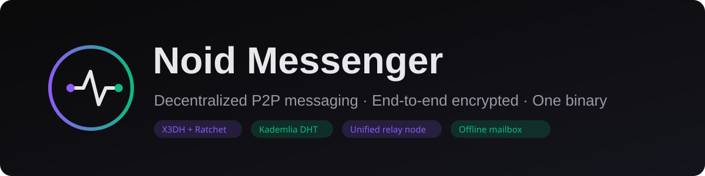
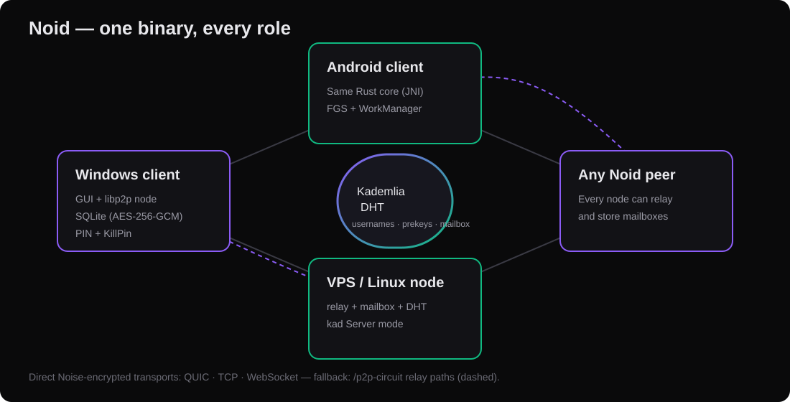

# Noid Messenger



**Decentralized, end-to-end-encrypted P2P messenger.** One binary is the
chat client, the Kademlia DHT node, the circuit relay and the offline
mailbox — no central server stores your messages, and there is no
separate relay service to run.

## Highlights

- **E2EE**: X3DH + Double Ratchet per contact; prekey bundles are
  Ed25519-signed and verified by every consumer.
- **PIN gate**: Argon2id → AES-256-GCM field encryption in SQLite;
  timed lockout on brute force; KillPIN wipes everything instantly.
- **Zero server**: Kademlia DHT for usernames, prekeys and mailbox
  pointers; `/p2p-circuit` relay for NAT traversal; offline envelopes
  parked on peer mailbox nodes.
- **Cross-platform**: Windows, Linux/VPS, Android — one Rust core
  (libp2p, Noise, QUIC/TCP/WebSocket, mDNS, AutoNAT) + Svelte 5 + Tauri 2.

## Status

**Interim stable — `noid_stable_2610` (2026-10-27).** Verified live:
bidirectional Windows ↔ VPS message delivery with persisted E2EE
history; 328 tests green. Android rebuild matrix is next. Full report:
[`docs/audit2510/12_prekey_recovery_followup.md`](docs/audit2510/12_prekey_recovery_followup.md)

## Manual / Руководство (EN + RU)

| Document | English | Русский |
|----------|---------|---------|
| Project description + current state | [PROJECT_DESCRIPTION_EN.md](docs/manual/PROJECT_DESCRIPTION_EN.md) | [PROJECT_DESCRIPTION_RU.md](docs/manual/PROJECT_DESCRIPTION_RU.md) |
| Presentation (text spec) | [PRESENTATION_EN.md](docs/manual/PRESENTATION_EN.md) | [PRESENTATION_RU.md](docs/manual/PRESENTATION_RU.md) |
| Installation & setup | [INSTALLATION_EN.md](docs/manual/INSTALLATION_EN.md) | [INSTALLATION_RU.md](docs/manual/INSTALLATION_RU.md) |
| Manual index | [docs/manual/README.md](docs/manual/README.md) | same |
| Graphics | [banner.svg](docs/manual/assets/banner.svg) · [architecture.svg](docs/manual/assets/architecture.svg) | same |

## Quick start

```bash
git clone <repo> && cd noid && npm install
npm run tauri dev            # dev
npm run tauri build          # release bundle
```

Headless node: `cargo build --release --bin noid`, open ports
`4020/tcp+udp` and `4021/tcp`, run one process — it is the app, the
relay and the mailbox at once.

## Architecture



## Credits

Built by amissa_domo. Significant parts of the codebase, security audit,
connection-stability remediation and this documentation were developed
with **Devin** ([devin.ai](https://devin.ai)) — thank you to the Devin
team.

## Donate

If You liked it - you are free to donate

ETH,BSC etc - 0x666a7C97Ec665dE1A16Bf3e700F929C2B8D8527a


## License

TBD.
