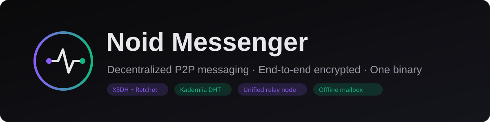

# Noid Messenger



**Decentralized, end-to-end-encrypted P2P messenger.** One binary is the
chat client, the DHT node, the circuit relay and the offline mailbox —
no central server stores your messages.

[Русская версия](README_RU.md) · [Project description EN](docs/manual/PROJECT_DESCRIPTION_EN.md) · [Описание RU](docs/manual/PROJECT_DESCRIPTION_RU.md)

## Highlights

- **E2EE**: X3DH + Double Ratchet per contact; signed prekey bundles.
- **PIN gate**: Argon2id → AES-256-GCM field encryption; timed lockout;
  KillPIN wipes everything instantly.
- **Zero server**: Kademlia DHT + `/p2p-circuit` relay + offline
  mailboxes — all inside the same binary.
- **Embedded Tor**: Arti client built in — stable `.onion` identity,
  onion dials, `off / additional / tor_only` (fail-closed) modes.
- **Cross-platform**: Windows, Linux/VPS, Android — one Rust core
  (libp2p, Noise, QUIC/TCP/WebSocket) + Svelte 5 + Tauri 2.

## Status — v0.2.0 (rebuilt 2026-11-11)

✅ Live-verified Windows ↔ Linux VPS ↔ Android: onion bootstrap,
relayed circuits, multi-path connectivity.
✅ Audit remediation: durable delivery ACKs, hardened wipe ordering,
instance lock, Android backup disabled.
⚠️ On networks with Tor DPI filtering, embedded Tor needs an external
VPN or bridges (planned). Plain P2P mesh works without Tor anywhere.

## Downloads

| Platform | Package |
|----------|---------|
| Windows (x64) | [setup.exe](https://github.com/RedBuffalo13/Noid/releases/download/v0.2.0/noid-windows-x64-setup.exe) · [msi](https://github.com/RedBuffalo13/Noid/releases/download/v0.2.0/noid-windows-x64.msi) · [portable](https://github.com/RedBuffalo13/Noid/releases/download/v0.2.0/noid-windows-x64.exe) |
| Linux (x86_64) | [deb](https://github.com/RedBuffalo13/Noid/releases/download/v0.2.0/Noid_0.2.0_amd64.deb) · [AppImage](https://github.com/RedBuffalo13/Noid/releases/download/v0.2.0/Noid_0.2.0_amd64.AppImage) · [headless binary](https://github.com/RedBuffalo13/Noid/releases/download/v0.2.0/noid-linux-x86_64) |
| Android (arm64) | [noid-android-arm64.apk](https://github.com/RedBuffalo13/Noid/releases/download/v0.2.0/noid-android-arm64.apk) (sideload) |

## Quick start

```bash
# desktop app
noid-windows-x64-setup.exe          # install → set TruePIN → add peers by invite

# headless VPS node (relay + mailbox + DHT in one process)
chmod +x noid-linux-x86_64 && ./noid-linux-x86_64
ufw allow 4020/tcp && ufw allow 4021/tcp && ufw allow 4020/udp
```

More scenarios — onion on mobile, VPS/home permanent relay, privacy
modes: [Project description](docs/manual/PROJECT_DESCRIPTION_EN.md).

## Docs

| Document | EN | RU |
|----------|----|----|
| Description + quick-start cases | [link](docs/manual/PROJECT_DESCRIPTION_EN.md) | [link](docs/manual/PROJECT_DESCRIPTION_RU.md) |
| Installation & setup | [link](docs/manual/INSTALLATION_EN.md) | [link](docs/manual/INSTALLATION_RU.md) |
| Presentation | [link](docs/manual/PRESENTATION_EN.md) | [link](docs/manual/PRESENTATION_RU.md) |

## Credits

Built by amissa_domo. Significant parts of the codebase, security audit
and documentation were developed with **Devin** ([devin.ai](https://devin.ai)).

Open to co-development — bring ideas.

## License

TBD.
