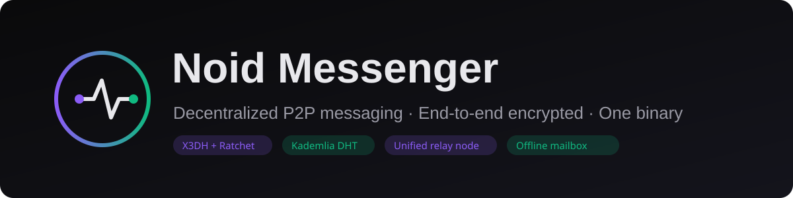

# Noid Messenger



**Децентрализованный P2P-мессенджер со сквозным шифрованием.** Один
бинарник — это чат-клиент, узел DHT, релей и офлайн-почтовый ящик.
Ни один центральный сервер не хранит сообщения.

[English version](README.md) · [Описание RU](docs/manual/PROJECT_DESCRIPTION_RU.md) · [Description EN](docs/manual/PROJECT_DESCRIPTION_EN.md)

## Ключевое

- **E2EE**: X3DH + Double Ratchet на каждый контакт; подписанные
  prekey-бандлы.
- **PIN-gate**: Argon2id → AES-256-GCM шифрование полей; тайм-локаут при
  переборе; KillPIN мгновенно стирает все данные.
- **Ноль сервера**: Kademlia DHT + `/p2p-circuit` релей + офлайн-ящики —
  всё в том же бинарнике.
- **Встроенный Tor**: Arti-клиент внутри — стабильная `.onion`
  идентичность, onion-дозвон, режимы `off / additional / tor_only`
  (fail-closed).
- **Кроссплатформа**: Windows, Linux/VPS, Android — единое Rust-ядро
  (libp2p, Noise, QUIC/TCP/WebSocket) + Svelte 5 + Tauri 2.

## Статус — v0.2.0 (пересборка 2026-11-11)

✅ Проверено вживую Windows ↔ Linux VPS ↔ Android: onion-bootstrap,
релейные цепочки, multi-path связность.
✅ Ремедиация аудита: durable ACK доставки, усиленный порядок wipe,
instance lock, Android backup отключён.
⚠️ В сетях с DPI-фильтрацией Tor нужен внешний VPN или мосты (в планах).
Обычный P2P-меш работает без Tor в любой сети.

## Скачать

| Платформа | Пакет |
|-----------|-------|
| Windows (x64) | [setup.exe](https://github.com/RedBuffalo13/Noid/releases/download/v0.2.0/noid-windows-x64-setup.exe) · [msi](https://github.com/RedBuffalo13/Noid/releases/download/v0.2.0/noid-windows-x64.msi) · [portable](https://github.com/RedBuffalo13/Noid/releases/download/v0.2.0/noid-windows-x64.exe) |
| Linux (x86_64) | [deb](https://github.com/RedBuffalo13/Noid/releases/download/v0.2.0/Noid_0.2.0_amd64.deb) · [AppImage](https://github.com/RedBuffalo13/Noid/releases/download/v0.2.0/Noid_0.2.0_amd64.AppImage) · [headless-бинарник](https://github.com/RedBuffalo13/Noid/releases/download/v0.2.0/noid-linux-x86_64) |
| Android (arm64) | [noid-android-arm64.apk](https://github.com/RedBuffalo13/Noid/releases/download/v0.2.0/noid-android-arm64.apk) (sideload) |

## Быстрый старт

```bash
# десктоп
noid-windows-x64-setup.exe          # установка → TruePIN → добавить пиров инвайтом

# headless-нода на VPS (релей + почтовый ящик + DHT в одном процессе)
chmod +x noid-linux-x86_64 && ./noid-linux-x86_64
ufw allow 4020/tcp && ufw allow 4021/tcp && ufw allow 4020/udp
```

Больше сценариев — onion на мобильном, постоянный релей на VPS/доме,
режимы приватности: [Описание проекта](docs/manual/PROJECT_DESCRIPTION_RU.md).

## Документы

| Документ | EN | RU |
|----------|----|----|
| Описание + кейсы быстрого старта | [link](docs/manual/PROJECT_DESCRIPTION_EN.md) | [link](docs/manual/PROJECT_DESCRIPTION_RU.md) |
| Установка и настройка | [link](docs/manual/INSTALLATION_EN.md) | [link](docs/manual/INSTALLATION_RU.md) |
| Презентация | [link](docs/manual/PRESENTATION_EN.md) | [link](docs/manual/PRESENTATION_RU.md) |

## Авторы

Проект amissa_domo. Значительная часть кодовой базы, аудит безопасности
и документация разработаны с **Devin** ([devin.ai](https://devin.ai)).

Открыт к совместной разработке — приносите идеи.

## Лицензия

TBD.
