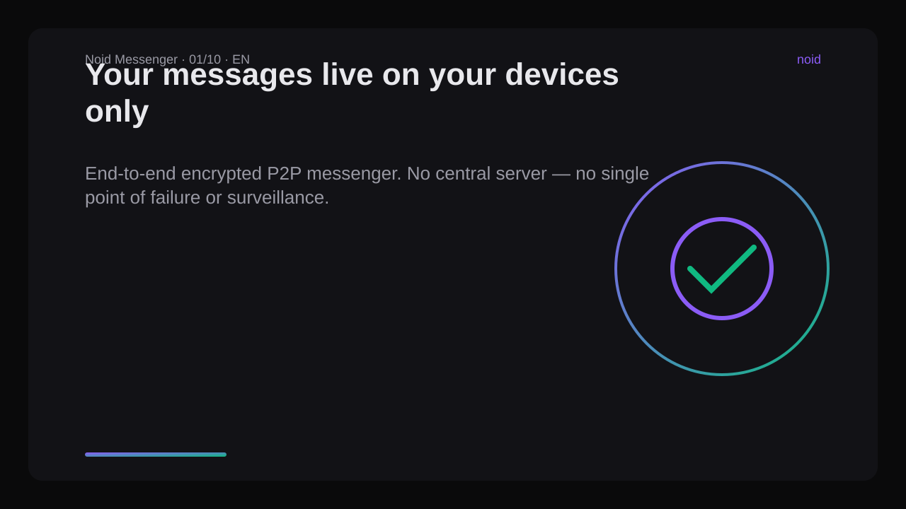
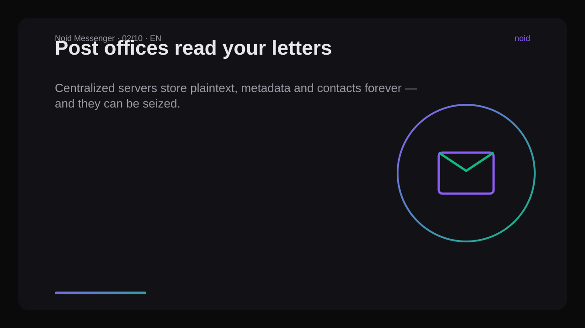
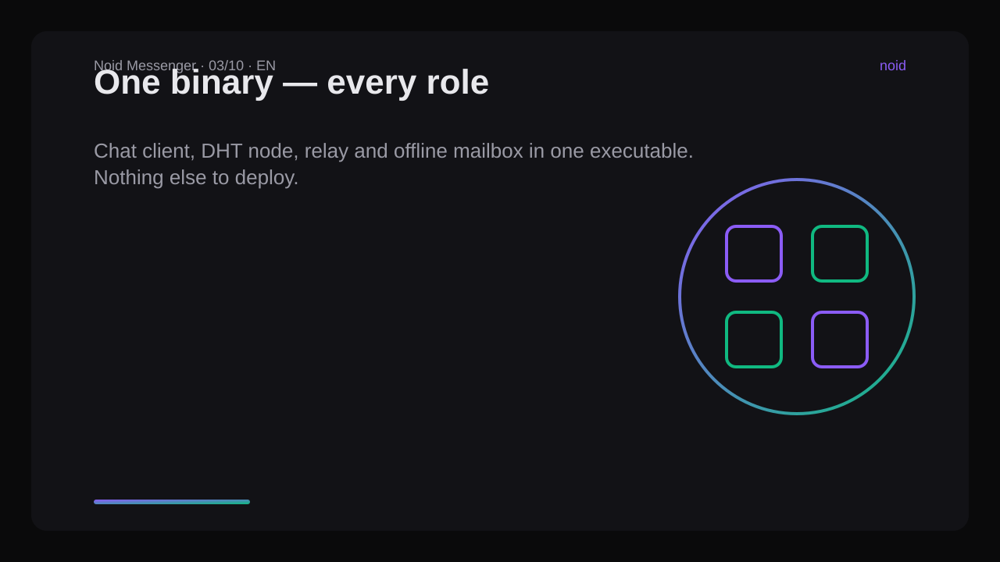
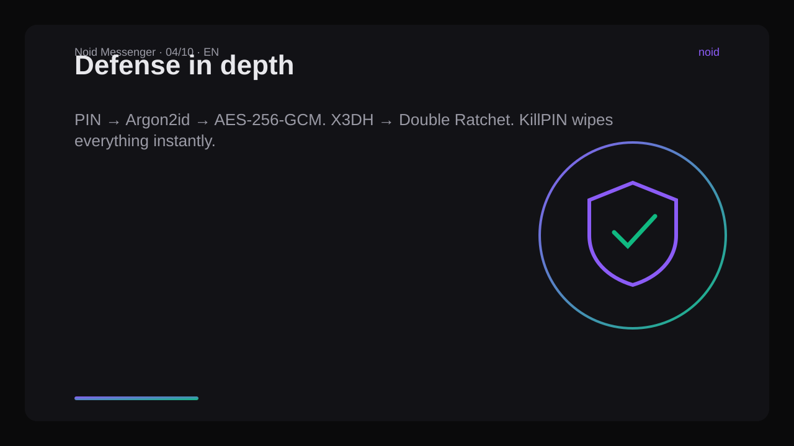
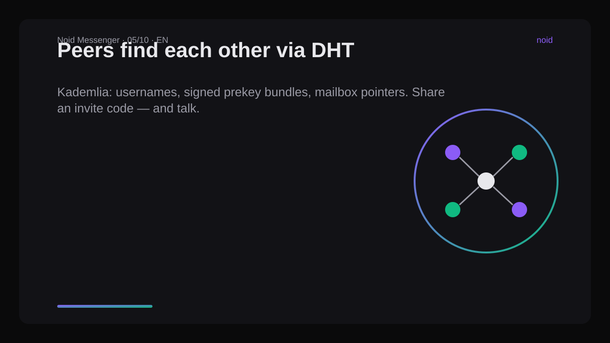
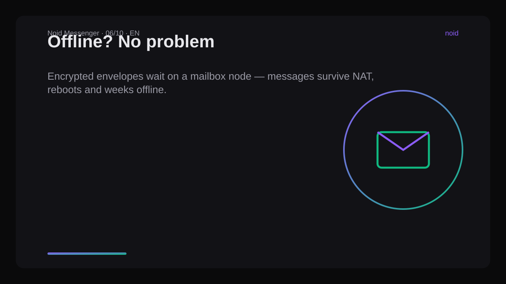
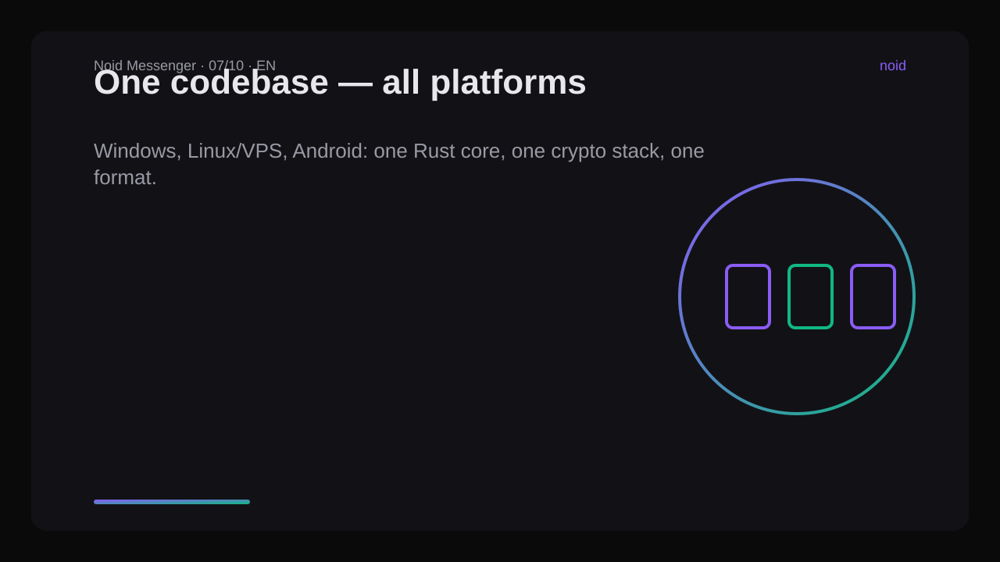
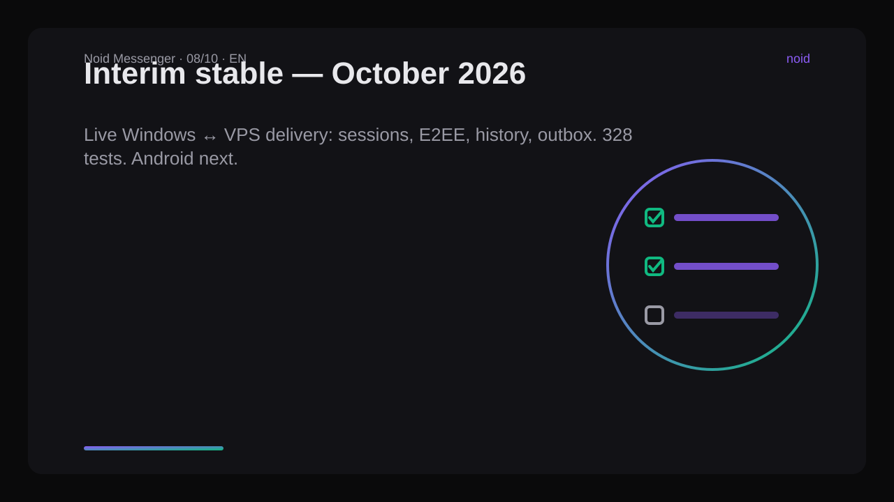
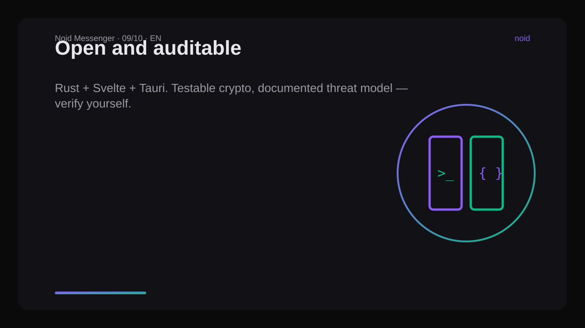
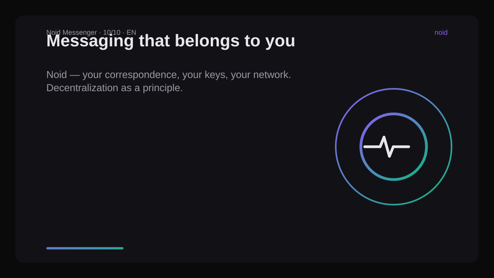

# Noid Messenger — Presentation Text (for visual generation)

> Slide-by-slide text for a presentation / video / landing page.
> Every slide has a headline, body text and a visual cue.

## Slide 1 — Title
**Noid Messenger**
Your messages exist only on your devices.

server icon anywhere.

## Slide 2 — The problem
Messengers today are post offices that read your letters.
Central servers store plaintext, metadata, contacts — forever.

## Slide 3 — The idea
No server. No relay service. One binary does everything:
chat client + DHT node + relay + offline mailbox.

## Slide 4 — Security in depth
PIN (Argon2id) → master key → AES-256-GCM storage.
X3DH handshake → Double Ratchet per contact.
Noise transport on QUIC/TCP/WebSocket.
KillPin erases everything instantly.

## Slide 5 — How peers find each other
Kademlia DHT: usernames, signed prekey bundles, mailbox pointers.
Invite codes carry addresses directly — invite → connect → talk.

## Slide 6 — Offline? No problem.
Encrypted envelopes wait in a mailbox node — another Noid client,
not a central server. Messages survive NAT, reboots, offline days.

## Slide 7 — Same code, every platform
Windows · Linux/VPS · Android — one Rust core, one crypto stack,
one file format. Headless nodes run on any VPS.

## Slide 8 — Status: interim stable (Oct 2026)
Windows ↔ VPS live delivery verified: sessions, encryption, persistence,
outbox draining. 328 tests green. Android matrix is next.

## Slide 9 — Open & auditable
Rust + Svelte + Tauri. Reproducible builds, testable crypto,
documented threat model — read the code, verify yourself.

## Slide 10 — The bottom line
Noid: messaging that belongs to you.

---
*Palette: #0a0a0b background, #121214 surfaces, #8b5cf6 violet accent,
#10b981 green accent, dark-first UI. Tone: confident, technical,
no marketing fluff.*
