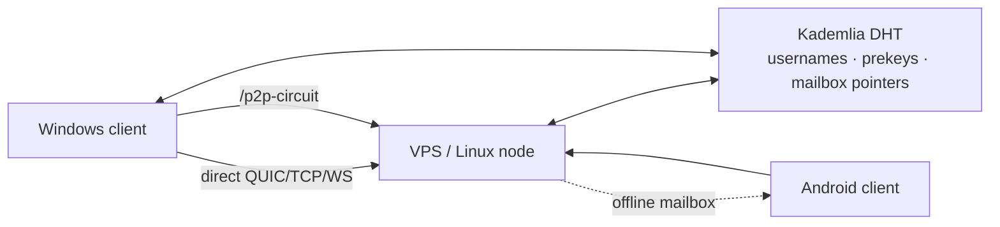
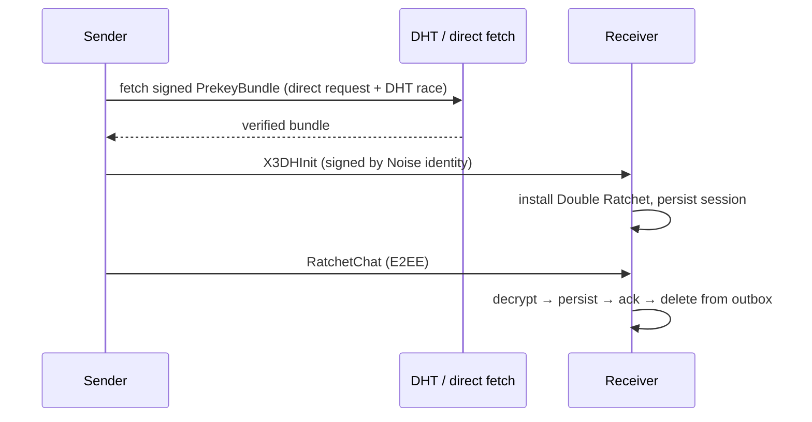

# Noid Messenger — Project Description

## What it is

Noid Messenger is a decentralized, end-to-end-encrypted P2P messenger.
One binary is simultaneously the chat client, a Kademlia DHT node, a
circuit relay and an offline mailbox — there is **no separate relay
service** and **no central message server** anywhere in the design.

- **Stack**: Svelte 5 + TypeScript frontend · Tauri 2 shell · Rust core
  (libp2p 0.54, Noise, Yamux, Kademlia, gossipsub, request-response,
  circuit relay v2, mDNS, AutoNAT) · SQLite (sqlx, WAL) local storage.
- **Platforms**: Windows, Linux/VPS, Android (same Rust core via JNI).
- **Identity**: Ed25519 PeerId, generated locally. Public IDs for
  contacts derive from the last 4 characters of the PeerId.

## Cryptography

- **PIN gate**: Argon2id → master key → AES-256-GCM field encryption for
  every sensitive column; 5+ failed attempts → persisted timed lockout;
  KillPin wipes the whole data directory.
- **Handshake**: X3DH (X25519 identity, signed prekey, OTPK pool of 10).
  Bundles are Ed25519-signed by the owner's Noise identity — the DHT
  store and every consumer verify owner + signature.
- **Sessions**: Double Ratchet per contact, persisted and restored;
  desync detection (3 consecutive decrypt failures) triggers a clean
  re-handshake.
- **Transport**: Noise (QUIC / TCP / WebSocket), optional `/p2p-circuit`
  relay paths. Nothing plaintext crosses the wire.
- **Offline delivery**: per-peer mailbox nodes — encrypted envelopes
  parked on another Noid node (also this same binary), picked up later.

## Architecture

## Current state — interim stable (`noid_stable_2610`, 2026-10-27)

Verified live on updated Windows ↔ VPS builds:

- Ratchet sessions restore and persist (`ratchet_states` = 1 each side).
- 3 new bidirectional messages carried identical stable IDs in both
  databases, decrypted on receipt, left the sender outbox.
- Both history endpoints repeatedly return 16 rows; no new
  `No prekey bundle found` entries in fresh logs.
- WAN signed-prekey probe passed in 0.73 s (temporary identity).
- Test suite: 324 unit + 4 integration tests green; 3 WAN probes opt-in.

Fixes in this build:

- X3DH initiator DB self-deadlock → short-lived Database snapshot.
- Prekey fetch depended solely on DHT → direct request-response path
  races with DHT; dedup window prevents double session initiation.
- Transient bootstrap failures dead-marked seeds for 30 min → pinned and
  blind seeds now recover with a 60 s retry cap and address-book restore.
- Exact signed DHT record retries were refused as stale → idempotent
  verified retries (metadata untouched, forgeries still rejected).

Residual debt: Android rebuild/live matrix pending; long offline soak
not performed; two pre-control-test outbox rows remain queued on
Windows. Full report: `docs/audit2510/12_prekey_recovery_followup.md`.

## What it is not

- Not federated, not server-hosted: there is nothing to subpoena —
  messages exist only on endpoints and (encrypted) on chosen mailboxes.
- Relay operators see metadata (IP, timing, volume), never plaintext.
