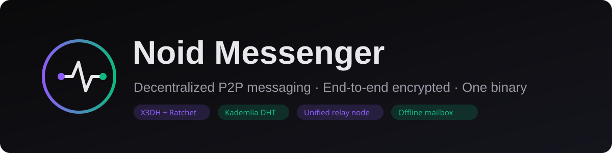
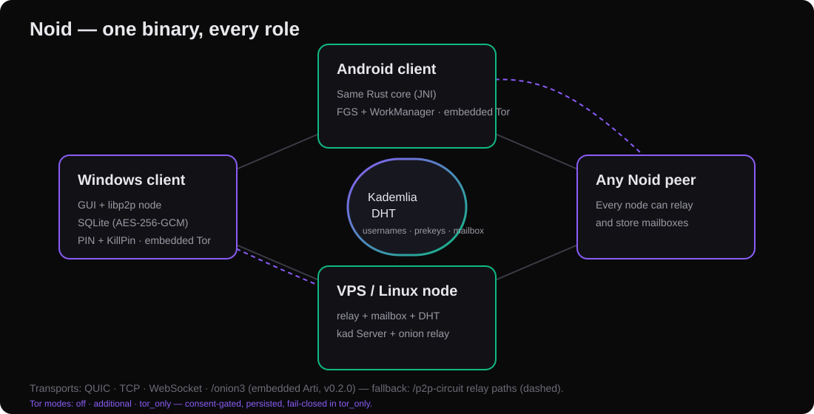
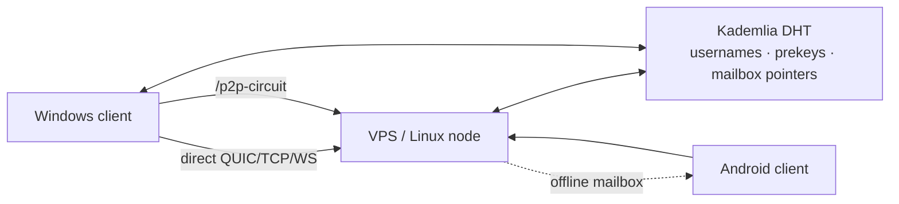
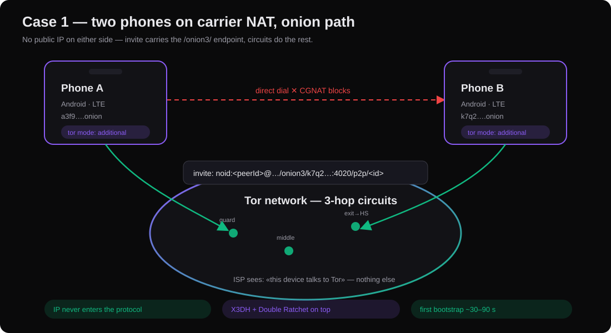
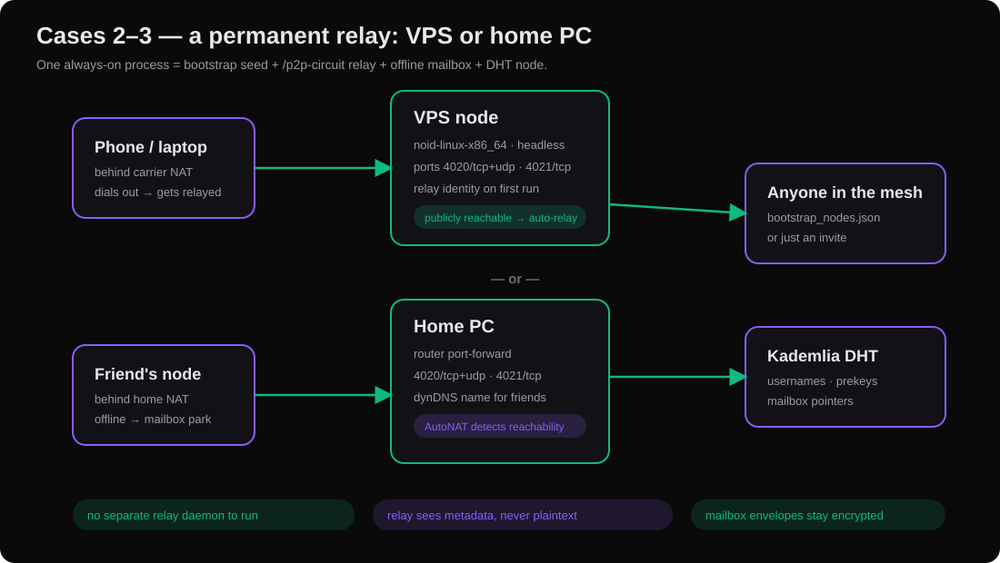
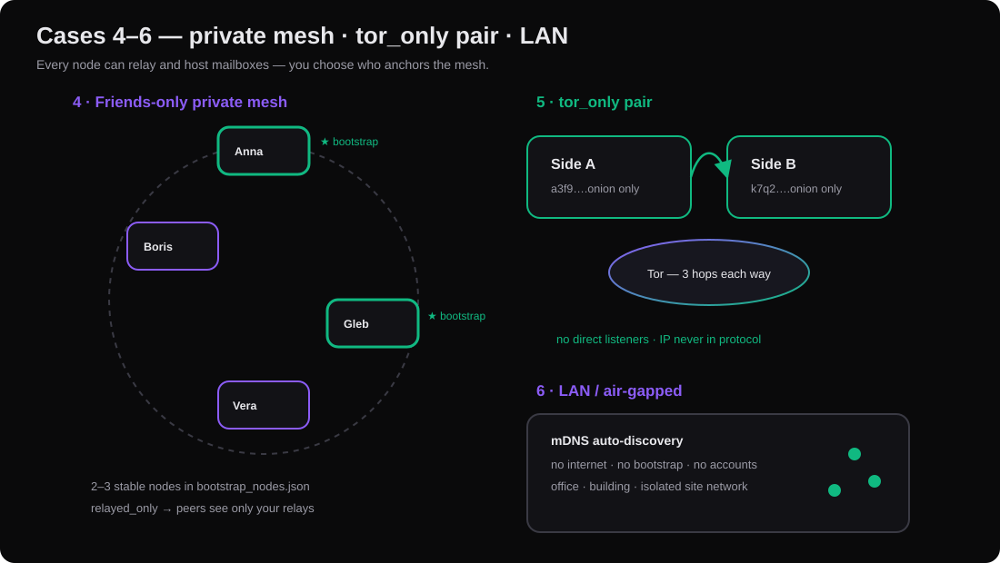
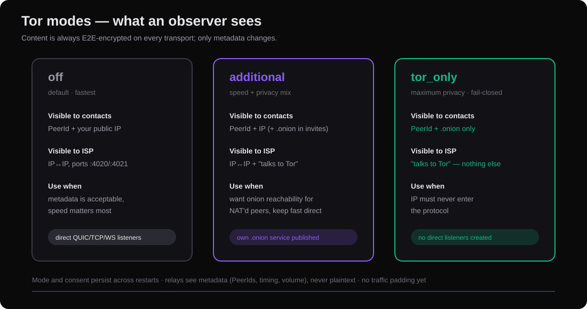

# Noid Messenger — Project Description



## What it is

Noid Messenger is a decentralized, end-to-end-encrypted P2P messenger.
One binary is simultaneously the chat client, a Kademlia DHT node, a
circuit relay and an offline mailbox — there is **no separate relay
service** and **no central message server** anywhere in the design.

- **Stack**: Svelte 5 + TypeScript frontend · Tauri 2 shell · Rust core
  (libp2p 0.54, Noise, Yamux, Kademlia, gossipsub, request-response,
  circuit relay v2, mDNS, AutoNAT) · SQLite (sqlx, WAL) local storage.
- **Platforms**: Windows, Linux/VPS, Android (same Rust core via JNI).
- **Identity**: Ed25519 PeerId, generated locally. Public IDs for
  contacts derive from the last 4 characters of the PeerId.

## Cryptography

- **PIN gate**: Argon2id → master key → AES-256-GCM field encryption for
  every sensitive column; 5+ failed attempts → persisted timed lockout;
  KillPin wipes the whole data directory.
- **Handshake**: X3DH (X25519 identity, signed prekey, OTPK pool of 10).
  Bundles are Ed25519-signed by the owner's Noise identity — the DHT
  store and every consumer verify owner + signature.
- **Sessions**: Double Ratchet per contact, persisted and restored;
  desync detection (3 consecutive decrypt failures) triggers a clean
  re-handshake.
- **Transport**: Noise (QUIC / TCP / WebSocket), optional `/p2p-circuit`
  relay paths. Nothing plaintext crosses the wire.
- **Offline delivery**: per-peer mailbox nodes — encrypted envelopes
  parked on another Noid node (also this same binary), picked up later.

## Architecture





## Quick-start cases

### 1. Two phones, cellular networks — onion mode



The hardest case: both peers behind carrier NAT, no public address,
APKs sideloaded. Direct dialing is impossible — and nothing needs to be
configured.

1. Install the APK on both devices → set TruePIN.
2. Settings → Tor → `additional` (or `tor_only` for maximum privacy) →
   accept the consent → wait for *Tor ready* (~30–90 s first time).
3. Exchange invite strings (messenger of choice, QR, NFC — the channel
   doesn't matter): the invite now carries the `/onion3/…` endpoint.
4. Chat. Messages ride 3-hop onion circuits; neither peer ever sees the
   other's IP. Offline envelopes park on mailbox nodes encrypted.

Tor DPI-blocking carrier? Switch to a non-filtering network or run an
external VPN — or add bridge lines (torrc format) under Settings →
Tor → "Tor bridges". Plain
P2P mode still works if at least one side is reachable.

### 2. VPS as a permanent relay



A cheap VPS makes the whole mesh reliable: it's a stable bootstrap
seed, a `/p2p-circuit` relay for NAT'd peers and a mailbox for offline
delivery — in one process.

```bash
scp noid-linux-x86_64 root@<vps>:/opt/noid/noid
ssh root@<vps>
chmod +x /opt/noid/noid && ufw allow 4020/tcp && ufw allow 4021/tcp && ufw allow 4020/udp
nohup /opt/noid/noid > /opt/noid/noid.log 2>&1 &
# first run generates relay identity + passphrase (0600) under ~/.config/noid-relay/
```

Point clients at it: add its address (`noid:<peerId>@/ip4/<vps>/tcp/4020/p2p/<id>`)
to `bootstrap_nodes.json` or simply exchange invites — after the first
circuit reservation, NAT'd peers become dialable through it.

### 3. Home PC behind NAT as the permanent node

No VPS? A home machine works too:

1. Run Noid (desktop or headless binary) — it's always-on anyway.
2. Forward ports **4020/tcp+udp** and **4021/tcp** on the router to that
   machine; reserve a static LAN IP for it.
3. The node auto-detects reachability (AutoNAT) and starts relaying;
   with a dynamic DNS name your friends get a permanent entry point.

Even without forwarding, the node still serves contacts through
outbound connections — forwarding just makes it a *public* relay.

### 4. Friends-only private mesh



You can run a small mesh entirely inside your group:

- Every node is a potential relay/mailbox — pick 2–3 stable ones (VPS
  or always-on home PCs) and put them in `bootstrap_nodes.json`.
- Privacy mode `relayed_only` hides every member's IP from the others'
  contacts — only your own relays see them.
- Add `tor_only` on top and even the relays disappear as observers.

### 5. Maximum-privacy pair (tor_only both ways)

Both sides set `tor_only`: no direct listeners are created, no IP ever
enters the protocol — only `.onion` addresses. Slower, but the only
network-visible fact is "this device talks to Tor".

### 6. LAN / air-gapped room

mDNS discovers peers on the local network automatically — no internet,
no bootstrap, no accounts. Useful for a building, an office, or an
isolated site network.

## Embedded Tor (v0.2.0)

An Arti 0.48 client (the official Rust Tor implementation) runs inside
the same binary — no external tor daemon, no Orbot, no proxy settings.

- **Identity**: a stable `.onion` address derived from a persistent
  ed25519 hsid key in the encrypted keystore (AES-256-GCM, domain
  `tor-keystore`); survives reinstalls, created offline at PIN login —
  no socket is opened before consent.
- **Modes** (`Settings → Tor`, persisted in `tor_config.json`):
  `off` (default), `additional` (onion alongside direct transports),
  `tor_only` (onion-only, fail-closed — direct listeners are not
  created at all).
- **Transport**: `/onion3/` multiaddr dialed/listened through the
  embedded client; Noise + Yamux multiplexing on top — the same
  authenticated stream as every other transport.
- **Invites**: `get_my_invite` appends the `/onion3/…:4020/p2p/<id>`
  endpoint automatically when the service is live.
- **Relay**: onion-relay opt-in is a separate switch + separate
  metered-traffic consent on Android; `/p2p-circuit` reservations can
  ride on onion transports.
- **Supervision**: generation-owned client/service with bounded
  shutdown, deduplicated rebuilds, `tor-status` event stream to the UI.
- **Limitation**: on networks with Tor DPI filtering the client needs
  an external VPN or bridge lines (Settings → Tor → "Tor bridges",
  persisted to `bridges.txt`, applied on every Tor restart).

## What an observer can see



Message **content** is always E2E-encrypted on every transport. What
differs is the metadata.

| Who sees | `off` | `additional` | `tor_only` |
|----------|-------|--------------|------------|
| Contacts | PeerId + your public IP | PeerId + IP (+ `.onion` if invited that way) | PeerId + `.onion` only — **IP never enters the protocol** |
| Relay nodes | Circuit: source↔dest PeerIds + volumes | Same, or onion-bound circuits | Same, no source IP |
| Mailbox node | Ciphertext envelopes + whose mailbox + timing | Same | Same, no sender IP |
| ISP / DPI | IP ↔ IP, fingerprintable ports :4020/:4021 | Same + "talks to Tor" | "Talks to Tor" — nothing else |

Residual risks on every transport: stable PeerId/onion pseudonymity,
envelope-size timing — there is no traffic padding yet.

## Current state — v0.2.0 (audit remediation rebuild, 2026-11-11)

- Ratchet send-guard prevents encrypting before first inbound DH;
  codec offset fix; deterministic X3DH glare resolution.
- Durable pending → delivered/mailbox ACK states; honest
  sending/sent/queued/delivered/failed statuses.
- Wipe ordering hardened: gate/epoch revoke → Tor identity drop →
  task drain → inbox clear → DB close.
- Room-control replay dedup (migration 019), durable unread counts
  (migration 020), file-transfer ACKs + inbox quotas.
- Instance lock on GUI and headless; Android `allowBackup=false` +
  data-extraction rules verified on a physical device.
- Verified: `cargo check` clean, 358/358 lib tests, svelte-check 0/0,
  166 vitest + 7 deepmerge tests; Linux headless relay smoke OK;
  Android install + launch on a real device OK.

Residual debt: live-Tor/WAN matrix and macOS builds not yet performed;
large-file decomposition is planned work.

## What it is not

- Not federated, not server-hosted: there is nothing to subpoena —
  messages exist only on endpoints and (encrypted) on chosen mailboxes.
- Relay operators see metadata (IP, timing, volume), never plaintext.
