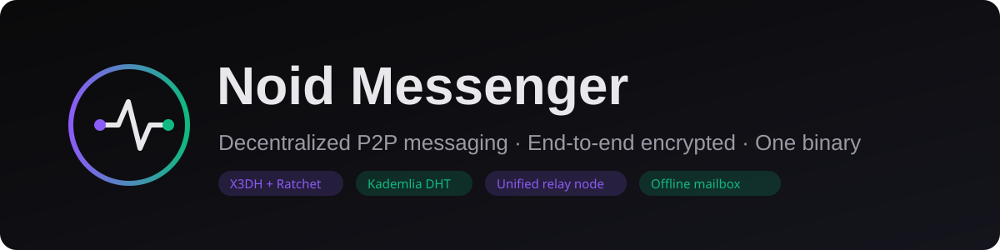
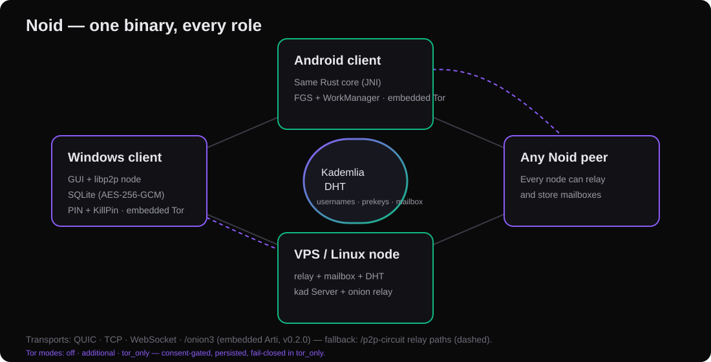
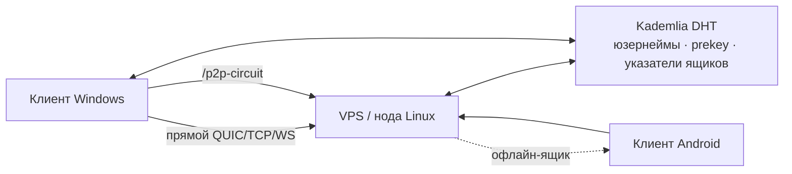
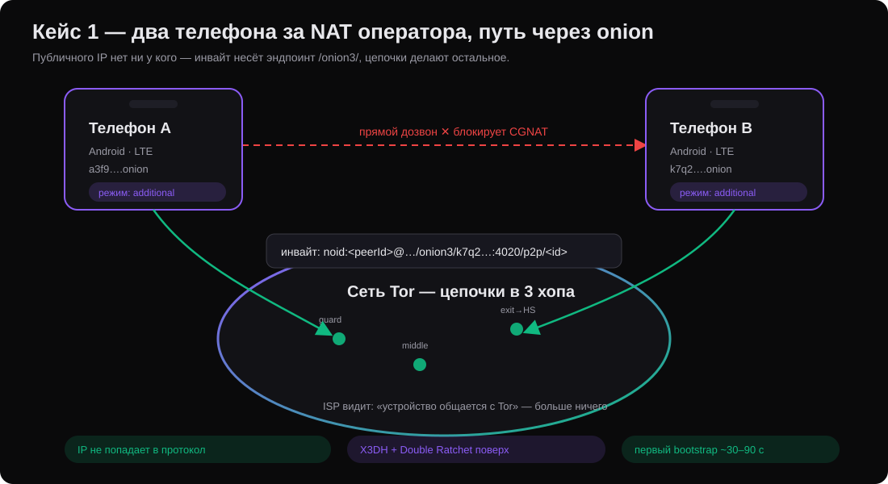
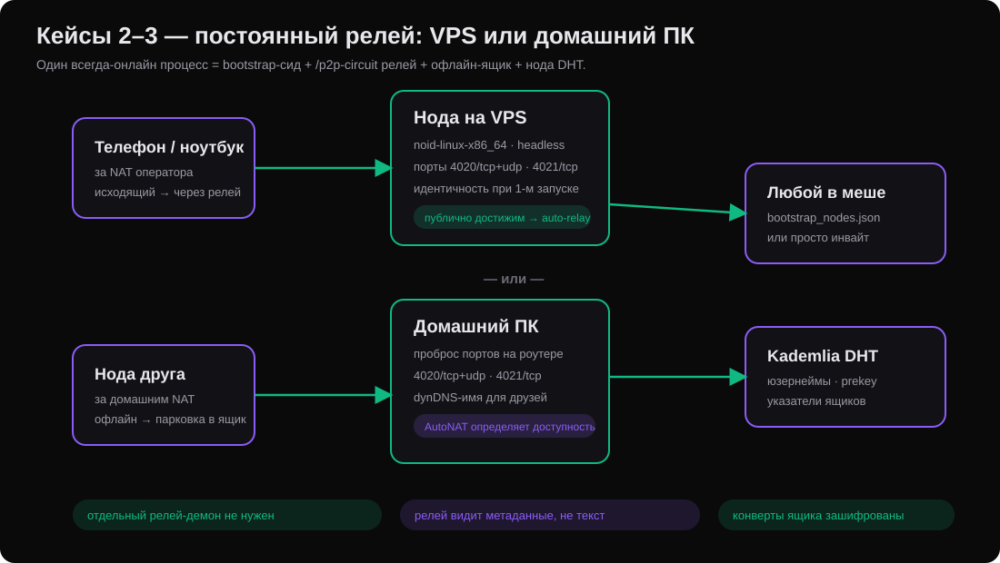
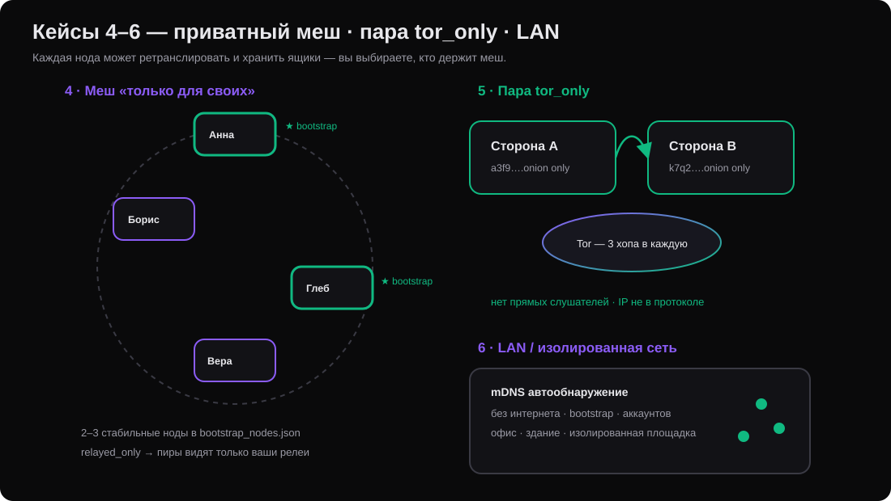
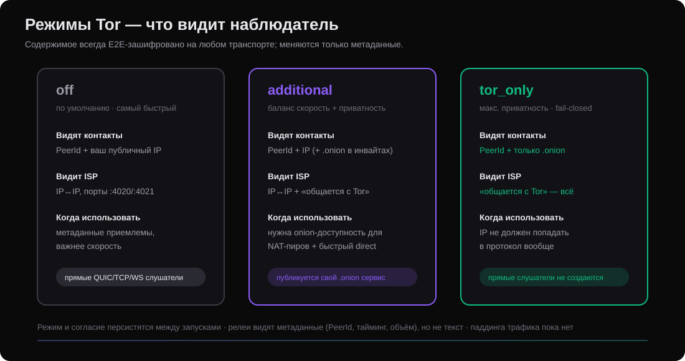

# Noid Messenger — Описание проекта



## Что это

Noid Messenger — децентрализованный P2P-мессенджер со сквозным
шифрованием. Один бинарник одновременно является чат-клиентом, узлом
Kademlia DHT, цепочечным релеем и офлайн-почтовым ящиком — в дизайне
**нет отдельного релей-сервиса** и **нет центрального сервера
сообщений**.

- **Стек**: фронтенд Svelte 5 + TypeScript · оболочка Tauri 2 · ядро на
  Rust (libp2p 0.54, Noise, Yamux, Kademlia, gossipsub,
  request-response, circuit relay v2, mDNS, AutoNAT) · локальное
  хранилище SQLite (sqlx, WAL).
- **Платформы**: Windows, Linux/VPS, Android (то же Rust-ядро через JNI).
- **Идентичность**: Ed25519 PeerId, генерируется локально. Публичные ID
  для контактов берутся из последних 4 символов PeerId.

## Криптография

- **PIN-gate**: Argon2id → мастер-ключ → AES-256-GCM шифрование каждого
  чувствительного поля; 5+ неудачных попыток → персистентный тайм-локаут;
  KillPin стирает всю директорию данных.
- **Рукопожатие**: X3DH (X25519 identity, signed prekey, пул OTPK на 10).
  Бандлы подписаны Ed25519 Noise-идентичностью владельца — хранилище DHT
  и каждый потребитель проверяют владельца и подпись.
- **Сессии**: Double Ratchet на контакт, персистируется и
  восстанавливается; детект десинхронизации (3 подряд неудачных
  расшифровки) запускает чистое повторное рукопожатие.
- **Транспорт**: Noise (QUIC / TCP / WebSocket), опциональные пути
  `/p2p-circuit`. Открытый текст не уходит в сеть.
- **Офлайн-доставка**: mailbox-ноды — зашифрованные конверты
  паркуются на другой Noid-ноде (тот же бинарник) и забираются позже.

## Архитектура





## Кейсы быстрого старта

### 1. Два телефона в мобильных сетях — режим onion



Самый сложный случай: оба за NAT оператора, публичных адресов нет, APK
поставлен через sideload. Прямой дозвон невозможен — и ничего
настраивать не нужно.

1. Установите APK на оба устройства → задайте TruePIN.
2. Настройки → Tor → `additional` (или `tor_only` для максимальной
   приватности) → примите согласие → дождитесь *Tor ready* (~30–90 с
   в первый раз).
3. Обменяйтесь инвайт-строками (любой канал — мессенджер, QR, NFC):
   инвайт уже содержит эндпоинт `/onion3/…`.
4. Общайтесь. Сообщения идут по 3-хоповым onion-цепочкам; ни одна
   сторона не видит IP другой. Офлайн-конверты паркуются на
   mailbox-нодах в зашифрованном виде.

Оператор блокирует Tor по DPI? Добавьте bridge-строки (torrc-формат)
в Настройки → Tor → «Tor-мосты» — клиент использует их при каждой
генерации Tor. Обычный P2P-режим работает, если хотя бы одна
сторона достижима.

### 2. VPS как постоянный релей



Дешёвый VPS делает весь меш надёжным: стабильный bootstrap-сид,
`/p2p-circuit` релей для NAT-пиров и почтовый ящик для офлайн-доставки —
в одном процессе.

```bash
scp noid-linux-x86_64 root@<vps>:/opt/noid/noid
ssh root@<vps>
chmod +x /opt/noid/noid && ufw allow 4020/tcp && ufw allow 4021/tcp && ufw allow 4020/udp
nohup /opt/noid/noid > /opt/noid/noid.log 2>&1 &
# первый запуск генерирует идентичность релея + пароль (0600) в ~/.config/noid-relay/
```

Направьте клиентов на него: добавьте адрес
(`noid:<peerId>@/ip4/<vps>/tcp/4020/p2p/<id>`) в `bootstrap_nodes.json`
или просто обменяйтесь инвайтами — после первой резервации цепочки
NAT-пиры становятся дозвонными через него.

### 3. Домашний ПК за NAT как постоянная нода

Нет VPS? Подойдёт домашняя машина:

1. Запустите Noid (десктоп или headless-бинарник) — она и так всегда
   включена.
2. Пробросьте порты **4020/tcp+udp** и **4021/tcp** на роутере на эту
   машину; закрепите за ней статический LAN-IP.
3. Нода сама определит достижимость (AutoNAT) и начнёт ретранслировать;
   с dynDNS-именем друзья получают постоянную точку входа.

Даже без проброса нода обслуживает контакты через исходящие соединения —
проброс просто делает её *публичным* релеем.

### 4. Приватный меш «только для своих»



Небольшую сеть можно поднять полностью внутри группы:

- Каждая нода — потенциальный релей/ящик; выберите 2–3 стабильных (VPS
  или всегда включённые домашние ПК) и впишите в `bootstrap_nodes.json`.
- Режим приватности `relayed_only` скрывает IP участников от чужих
  контактов — видеть их могут только ваши релеи.
- Добавьте `tor_only` сверху — и исчезнут даже релеи как наблюдатели.

### 5. Максимальная приватность — tor_only с двух сторон

Обе стороны ставят `tor_only`: прямые слушатели не создаются, IP не
появляется в протоколе — только `.onion`-адреса. Медленнее, но
единственное, что видит сеть, — «это устройство разговаривает с Tor».

### 6. LAN / изолированная сеть

mDNS автоматически находит пиров в локальной сети — без интернета,
bootstrap и аккаунтов. Полезно для здания, офиса или изолированной
площадки.

## Встроенный Tor (v0.2.0)

Клиент Arti 0.48 (официальная Rust-реализация Tor) работает внутри того
же бинарника — без внешнего tor-демона, Orbot и прокси-настроек.

- **Идентичность**: стабильный `.onion`-адрес из персистентного
  ed25519 hsid-ключа в зашифрованном хранилище (AES-256-GCM, домен
  `tor-keystore`); переживает переустановку, создаётся офлайн при входе
  по PIN — ни один сокет не открывается до согласия.
- **Режимы** (Настройки → Tor, персистятся в `tor_config.json`):
  `off` (по умолчанию), `additional` (onion рядом с прямыми
  транспортами), `tor_only` (только onion, fail-closed — прямые
  слушатели вообще не создаются).
- **Транспорт**: multiaddr `/onion3/` через встроенный клиент; Noise +
  Yamux поверх — тот же аутентифицированный поток, что и у остальных
  транспортов.
- **Инвайты**: `get_my_invite` автоматически добавляет эндпоинт
  `/onion3/…:4020/p2p/<id>`, когда сервис жив.
- **Релей**: onion-relay — отдельный opt-in переключатель + отдельное
  согласие на metered-трафик на Android; резервации `/p2p-circuit`
  могут идти поверх onion-транспортов.
- **Супервизия**: клиент/сервис с владением по генерации, ограниченный
  шатдаун, дедупликация пересборок, поток `tor-status` в UI.
- **Мосты**: в сетях с DPI-фильтрацией поддерживаются bridge-строки
  (torrc-формат) — Настройки → Tor → «Tor-мосты», сохраняются в
  `bridges.txt` и применяются при каждом перезапуске Tor.

## Что видит наблюдатель



**Содержимое** сообщений всегда E2E-зашифровано на любом транспорте.
Различаются только метаданные.

| Кто видит | `off` | `additional` | `tor_only` |
|-----------|-------|--------------|------------|
| Контакты | PeerId + ваш публичный IP | PeerId + IP (+ `.onion` если так приглашён) | PeerId + только `.onion` — **IP не попадает в протокол** |
| Релей-ноды | Цепочка: PeerId источника↔назначения + объёмы | То же, или цепочки через onion | То же, без IP источника |
| Mailbox-нода | Шифрованные конверты + чей ящик + тайминг | То же | То же, без IP отправителя |
| ISP / DPI | IP ↔ IP, узнаваемые порты :4020/:4021 | То же + «общается с Tor» | «Общается с Tor» — больше ничего |

Остаточные риски на любом транспорте: стабильная псевдонимность
PeerId/onion, тайминги по размеру конвертов — трафик-паддинга пока нет.

## Текущее состояние — v0.2.0 (пересборка после аудита, 2026-11-11)

- Send-guard ратчета запрещает шифрование до первого входящего DH;
  исправление codec offset; детерминированный арбитраж X3DH glare.
- Durable статусы pending → delivered/mailbox ACK; честные
  sending/sent/queued/delivered/failed.
- Усиленный порядок wipe: revoke gate/epoch → сброс Tor-идентичности →
  дрейн задач → очистка inbox → закрытие БД.
- Дедупликация replay room-control (миграция 019), durable unread-счётчики
  (миграция 020), ACK передачи файлов + квоты inbox.
- Instance lock на GUI и headless; Android `allowBackup=false` +
  правила data-extraction проверены на физическом устройстве.
- Проверено: `cargo check` чисто, 358/358 lib-тестов, svelte-check 0/0,
  166 vitest + 7 deepmerge тестов; Linux headless relay smoke OK;
  установка + запуск на реальном устройстве OK.

Остаточный долг: live-Tor/WAN матрица и сборки macOS ещё не выполнены;
декомпозиция крупных файлов — плановая работа.

## Чем это не является

- Не федерация и не хостинг на сервере: некого вызвать повесткой —
  сообщения существуют только на конечных устройствах и (в шифрованном
  виде) на выбранных ящиках.
- Операторы релеев видят метаданные (IP, тайминг, объём), но никогда —
  открытый текст.
