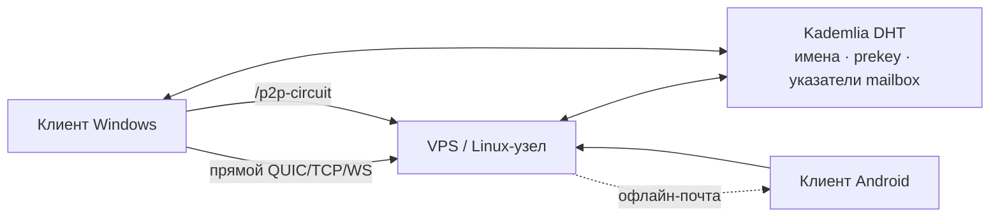
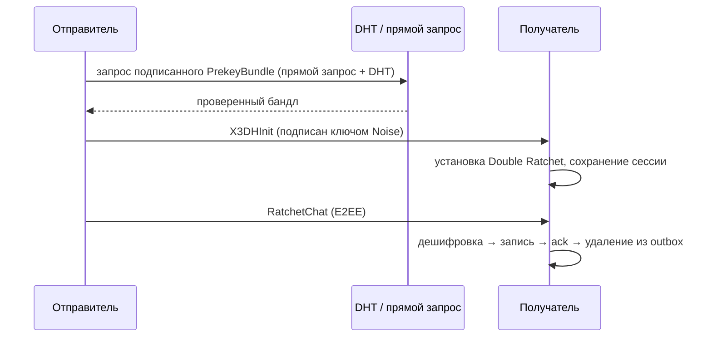

# Noid Messenger — Описание проекта

## Что это

Noid Messenger — децентрализованный P2P-мессенджер со сквозным
шифрованием. Один бинарник — это одновременно чат-клиент, узел
Kademlia DHT, circuit-релей и офлайн-почтовый ящик: **никакого
отдельного релей-сервиса** и **никакого центрального сервера
сообщений** в архитектуре нет.

- **Стек**: Svelte 5 + TypeScript · оболочка Tauri 2 · ядро Rust
  (libp2p 0.54: Noise, Yamux, Kademlia, gossipsub, request-response,
  circuit relay v2, mDNS, AutoNAT) · локальное хранилище SQLite
  (sqlx, WAL).
- **Платформы**: Windows, Linux/VPS, Android (то же ядро через JNI).
- **Идентичность**: Ed25519 PeerId, генерируется локально. Публичный ID
  контакта — последние 4 символа PeerId.

## Криптография

- **PIN**: Argon2id → мастер-ключ → AES-256-GCM для каждого
  чувствительного поля; 5+ ошибок → персистентная временная блокировка;
  KillPin стирает весь каталог данных.
- **Рукопожатие**: X3DH (X25519, signed prekey, пул OTPK из 10). Бандлы
  подписаны Ed25519-ключом владельца — DHT-хранилище и каждый потребитель
  проверяют владельца и подпись.
- **Сессии**: Double Ratchet на контакт, сохраняется и восстанавливается;
  при 3 подряд ошибках дешифрования — чистое повторное рукопожатие.
- **Транспорт**: Noise поверх QUIC / TCP / WebSocket, запасной путь —
  `/p2p-circuit`. Открытый текст в сеть не уходит.
- **Офлайн-доставка**: персональные mailbox-узлы — зашифрованные
  конверты хранятся на другом узле Noid (тот же бинарник) до подключения.

## Архитектура

## Текущее состояние — промежуточно стабильная сборка (`noid_stable_2610`, 27.10.2026)

Проверено живьём на обновлённых сборках Windows ↔ VPS:

- Ratchet-сессии восстанавливаются и сохраняются (`ratchet_states` = 1
  с каждой стороны).
- 3 новых сообщения в обе стороны получили одинаковые ID в обеих базах,
  расшифрованы при приёме и удалены из outbox отправителя.
- Обе истории стабильно отдают по 16 строк; свежих
  `No prekey bundle found` в логах нет.
- WAN-проба получения подписанного prekey — 0,73 с (временная личность).
- Тесты: 324 unit + 4 интеграционных — зелёные; 3 WAN-пробы опциональны.

Исправления этой сборки:

- Deadlock инициатора X3DH на глобальном mutex БД → короткий снимок
  Database.
- Prekey зависел только от DHT → прямой request-response гонит с DHT;
  окно дедупликации исключает повторную инициацию сессии.
- Временные сбои bootstrap помечали seed «мёртвым» на 30 мин → seed-узлы
  восстанавливаются с капом ретрая 60 с и возвратом адресов.
- Точные повторы подписанных записей DHT отвергались как stale →
  идемпотентные ретраи (метаданные не трогаются, подделки отвергаются).

Остаток техдолга: Android — пересборка и живая проверка; длительный
офлайн-soak не проводился; две древних строки outbox на Windows ещё в
очереди. Полный отчёт: `docs/audit2510/12_prekey_recovery_followup.md`.

## Чем Noid не является

- Не федерация и не хостинг: нечего изъять — сообщения живут только на
  устройствах сторон и (в шифрованном виде) на выбранных mailbox.
- Оператор релея видит лишь метаданные (IP, тайминги, объём), но не текст.
